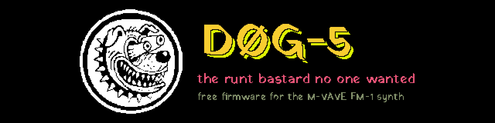

# DØG-5

**Custom firmware for the M-VAVE FM-1 pocket synth, for the band DØGS.** An aggressive, live, virtual-analog voice (8
voices, a Psych Chain of GROWL / ALLEY / DRAIN / CHEW after them, 99 program slots with 32 factory patches). Free and
open source, GPL-3.0-only. The build brief and the reasoning are in [`CLAUDE.md`](CLAUDE.md) and [`dog5-docs/`](dog5-docs/).

> **Tested on one unit, with the older flash chip.** DØG-5 is built and tested on a real FM-1 with the **Puya P25Q80**
> flash chip (JEDEC `0x856014`). Newer FM-1s carry the **UC25HQ80** (JEDEC `0xB36014`): the update loader accepts it, but
> DØG-5 has **never been installed or played on one**, so we cannot speak to how it behaves there. On a newer unit, keep
> M-Flasher and your backup ready, and please report what happens.

**Status (21 Nov 2026): a pre-release test build, v0.4.4, package identity `FM-1_964`, on the unit and tested.** HOME is
the chapter's scene, with the dog and his bark as the live scope; a turned knob shows as a dial; the fence breaks where the
bark lands; FLEAS dirties the screen (never the sound); the boot animation; the DØG-5 look on every screen. Installed
from stock, over another Hub firmware and back again, and the stock backup restored with M-Flasher. Made for the
**FM-1 only** (the SMK-37 is not supported).

**Install it:** the self-hosted installer page, [`docs/install/`](docs/install/README.md) (Chrome or Edge, over USB:
<https://vincentzsk-prod.github.io/dog5/install/>). It carries the package inside
the page, shows what it will write, has a dry run, and resumes an interrupted install. From a terminal:
`python3 tools/fm1_install.py docs/install/dog5-0.4.4-20261121.fwsc`. If the unit will not boot: M-Flasher and your backup.

**Build it:** `./build.sh --release 0.4.4` makes `build/dog5-0.4.4.fwsc` (identity `FM-1_964`; a dev build is `build/dog5.fwsc`,
`FM-1_960`); `python3 tools/make_installer_page.py --release 0.4.4` regenerates the installer page and its package together.
The product's name and identity live in one file, [`firmware/src/dog5_id.h`](firmware/src/dog5_id.h).

**Play it in your browser:** <https://vincentzsk-prod.github.io/dog5/play/> is the firmware itself (the same C sources,
compiled to WebAssembly). Rebuild it with `sh web/sim/build.sh` (the two tools it needs are listed in that script).

**Test it:** a plain `./build.sh` last, then `sh tests/run_tests.sh` (host app, program store, update path, browser player,
installer page; no hardware). `CLAUDE.md` §9 has the whole dev setup.

**Credits.** DØG-5 by ZIGGY (DØGS). **DØG-5 is a fork of OberVave v1.5.3 (pinned)** by
[zvenson](https://github.com/zvenson/obervave) (`zvenson/obervave`, tag `v1.5.3`, commit `7e1ccf9`), which stands on
[Dinghy](https://github.com/zvenson/dinghy), [Felucca](https://github.com/hugelton/Felucca) (Leo Kuroshita, Hügelton
Instruments) and [SLOOP](https://github.com/isod89/sloop-fm1) (isod89). Everything inherited keeps its copyright and
licence; see [`NOTICE`](NOTICE), [`LICENSING.md`](LICENSING.md) and [`LICENSE`](LICENSE) (GPL-3.0-only).

OberVave's own README (the base this was forked from) is upstream at
[`zvenson/obervave@v1.5.3`](https://github.com/zvenson/obervave/tree/v1.5.3) and in this repo's git history.
